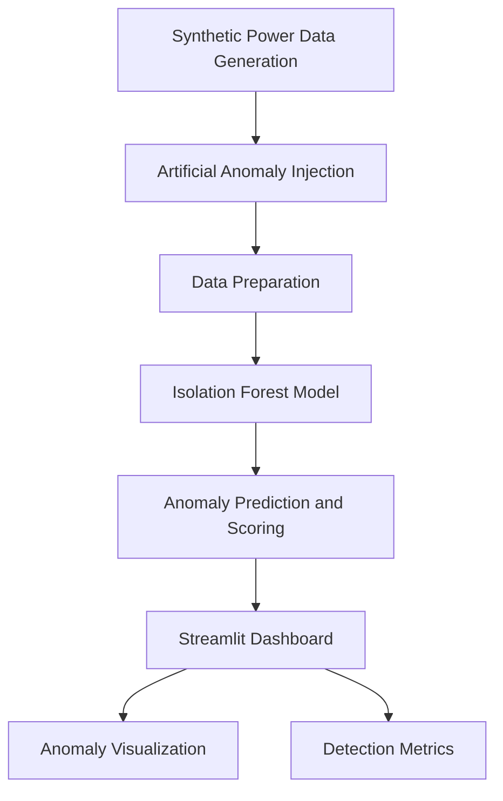
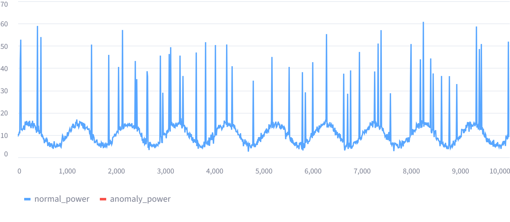
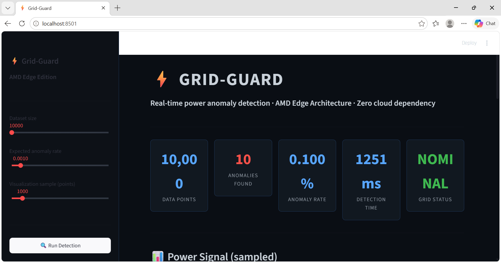

Grid-Guard: Local Power Anomaly Detector

A Python-based machine learning project for identifying unusual patterns in power consumption data using Isolation Forest.

1. Project Overview

Grid-Guard is a machine learning-based project that explores anomaly detection in power consumption time-series data.

The system generates synthetic power consumption data, introduces artificial anomalies, and applies the Isolation Forest algorithm to identify unusual observations.

The detected anomalies and consumption patterns are presented through an interactive Streamlit dashboard.

2. Problem Statement

Power consumption datasets may contain irregular patterns that differ from normal consumption behaviour. Identifying these irregularities is an important aspect of data monitoring and analysis.

This project explores how unsupervised machine learning can be applied to detect unusual patterns in simulated electricity consumption data.

3. Project Objectives

- Generate synthetic power consumption time-series data.
- Simulate unusual consumption patterns by introducing artificial anomalies.
- Apply Isolation Forest for unsupervised anomaly detection.
- Analyse and visualize detected anomalies.
- Develop an interactive dashboard for presenting the results.

4. Architecture




 5. Why Isolation Forest?

Isolation Forest was selected because it is an unsupervised machine learning algorithm suitable for detecting unusual observations in numerical datasets.

Reasons for selecting this algorithm:

- **Unsupervised learning:** Does not require labelled training data to identify potential anomalies.
- **Isolation-based approach:** Uses random tree partitions to isolate observations. Anomalies are often isolated in fewer partitions.
- **Numerical data compatibility:** Suitable for analysing numerical power-consumption readings.
- **Scikit-learn integration:** Provides an accessible Python implementation.
- **Anomaly scoring:** Provides decision scores alongside anomaly predictions.

In Grid-Guard, the model uses the power-consumption feature to identify potential anomalies.
```

6. Technology Stack

Component| Technology
Programming Language| Python
Machine Learning| Scikit-learn
Algorithm| Isolation Forest
Data Processing| Pandas, NumPy
Dashboard| Streamlit

7. Methodology

The project follows a sequence of processing stages:

Stage 1: Synthetic Data Generation

Generate simulated power consumption time-series data to represent consumption patterns.

Stage 2: Anomaly Injection

Introduce artificial irregularities into the generated dataset to simulate unusual consumption behaviour.

Stage 3: Anomaly Detection

Apply the Isolation Forest algorithm to identify observations that differ from the general data distribution.

Stage 4: Results Visualization

Present consumption patterns and detected anomalies through a Streamlit dashboard.

8. System Workflow

Synthetic Power Consumption Data
              |
              v
       Anomaly Injection
              |
              v
        Data Processing
              |
              v
       Isolation Forest
              |
              v
       Anomaly Detection
              |
              v
      Streamlit Dashboard

9. Repository Structure

AMD-SLINGSHOT/
|
|-- app.py
|-- detector.py
|-- requirements.txt
|-- grid-guard-preview.html
|-- README.md

10. Installation and Execution

Step 1: Clone the Repository

git clone https://github.com/PrithaRakshit/AMD-SLINGSHOT.git

Step 2: Navigate to the Project Directory

cd AMD-SLINGSHOT

Step 3: Install Dependencies

pip install -r requirements.txt

Step 4: Run the Application

streamlit run app.py

11. Current Scope and Limitations

- The current implementation uses synthetic power consumption data.
- Artificial anomalies are introduced to simulate irregular consumption patterns.
- The model has not yet been validated on real-world electricity consumption datasets.
- Detection performance and generalization to real-world conditions require further evaluation.

12. Future Scope

- Evaluate the model using real-world electricity consumption datasets.
- Compare Isolation Forest with alternative anomaly detection algorithms.
- Explore explainable machine learning techniques for interpreting detected anomalies.
- Investigate integration with IoT-based power monitoring systems.
- Explore real-time anomaly detection using live data sources.

13. Author

Pritha Rakshit

B.Tech – Information Technology

GitHub: "PrithaRakshit" (https://github.com/PrithaRakshit)

---

14. Dashboard Screenshot



15. Dashboard Overview



An exploratory project focused on machine learning, time-series analysis, and anomaly detection.
